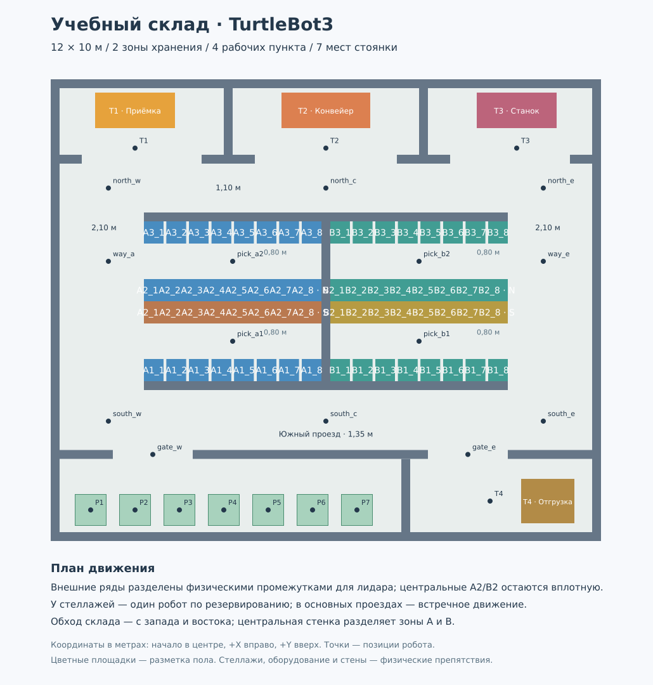

# Учебный производственный склад



Компактный мир Gazebo Classic 11 для ROS 2 Humble. Геометрия предусматривает
семь мест стоянки и встречное движение; управление группой нужно реализовать отдельно.

## Геометрия и назначение

Внутренний размер — **12 × 10 м, 120 м²**. Начало координат находится в центре
помещения; X направлен вправо, Y вверх на плане. Размеры ниже — свободное
расстояние между поверхностями препятствий.

| Элемент | Размер / устройство |
|---|---|
| Стоянка P | Одна общая зона, семь мест P1–P7 по 0,7 × 0,7 м, шаг 1 м |
| Хранение A и B | По три параллельных стеллажа в каждой зоне |
| A1, A3, B1, B3 | По восемь отдельных стеллажей 0,44 × 0,5 × 0,9 м; зазоры между ними ≈ 0,07 м |
| A2 и B2 | По восемь вплотную стоящих двусторонних секций 0,5 × 1 × 0,9 м |
| Проходы между рядами | 0,8 м; обслуживание одним роботом по резервированию |
| Центральная стенка | Разделяет A и B; по обе стороны тупиковые разворотные проходы шириной 0,8 м |
| Западный и восточный проезды | 2,1 м |
| Южный поперечный проезд | 1,35 м между двумя горизонтальными стенками |
| Северный поперечный проезд | Минимум 1,1 м под выступами перегородок рабочих пунктов |
| Входы в T1 / T2 / T3 | 2,7 / 3,2 / 2,7 м |
| Перегородка | Толщина 0,2 м, высота 1 м, два въезда по 1,8 м |
| Внешние стены | Толщина 0,2 м, высота 1,2 м |
| T1 | Приёмка материалов на севере слева |
| T2 | Конвейер комплектации на севере по центру |
| T3 | Подача деталей в станок на севере справа |
| T4 | Отгрузка в юго-восточной части |

Это уменьшенная учебная модель потока «приёмка → хранение → комплектация /
обработка → отгрузка». Служебная полоса со стоянкой отделена от зоны хранения
перегородкой. Западный въезд ведёт на стоянку, восточный — к отгрузке.
Дополнительная нижняя стенка разделяет эти помещения: путь от стоянки к T4
обязательно проходит через оба въезда и южный поперечный проезд.
За припаркованными роботами не нужно объезжать: выезд идёт в свободную полосу
перед стоянкой. Эта служебная полоса уже основных проездов и рассчитана на
последовательный выезд роботов. Конвейер и станок статические: погрузка
моделируется остановкой и сообщением программы, как в основной лабораторной.

По пользовательскому эскизу добавлены верхняя и нижняя стенки складского блока,
центральная разделительная стенка, перегородки с выступами между T1, T2 и T3,
короткие выступы у внешних стен и разделитель стоянки / отгрузки. Всего добавлено
10 простых стенок. Каждый ряд хранения продлён до центральной стены: стеллажи
A заканчиваются у её западной поверхности, B — у восточной. Крайние ряды
A1/B1 и A3/B3 сдвинуты на 0,25 м наружу, чтобы удвоение A2/B2 не уменьшило
межстеллажные проходы.

A2 и B2 — стеллажи «спина к спине»: северная сторона N содержит синие / бирюзовые
коробки, южная S — коричневые / охристые. Каждая сторона имеет свои восемь
квадратных секций. На схеме и в Gazebo стороны различаются цветом; точки
`pick_a1` / `pick_b1` обслуживают южную сторону, `pick_a2` / `pick_b2` — северную.
Поза каждой точки направлена к соответствующим коробкам.

## Почему проходят Burger и Waffle

Для масштаба использованы габариты ROBOTIS: Burger 0,138 × 0,178 м,
Waffle Pi 0,281 × 0,306 м
([спецификации производителя](https://emanual.robotis.com/docs/en/platform/turtlebot3/features/)).
Дополнительно проверена локальная SDF-модель Waffle: корпус смещён относительно
`base_footprint`, поэтому оценка поворота только по половине ширины недостаточна.
В профилях склада используются консервативные радиусы 0,15 м для Burger и
0,25 м для Waffle / Waffle Pi в обеих картах стоимости Nav2.

Геометрическая проверка использует круг радиусом **0,30 м**: расчётный габарит
Waffle плюс 0,05 м запаса. Все точки, проезды и межстеллажные проходы связаны
для этого круга. В середине прохода 0,8 м остаётся по 0,1 м до препятствий
от проверяемого круга. На боковых основных проездах шириной 2,1 м помещаются несколько
таких габаритов; для первых групповых опытов достаточно 2–4 роботов.

Ширина 0,8 м **не является физическим запретом разъезда двух роботов**.
Для обучения проходы у стеллажей нужно считать ресурсом вместимостью один робот.
Особенно для Burger геометрически возможен разъезд, но в задании диспетчер
должен запретить одновременный въезд. Это сохраняет удобство движения Waffle.

`inflation_radius: 0.35` используется в локальной и глобальной costmap. Это
расстояние распространения стоимости препятствия, а не дополнительный твёрдый
габарит робота. Не увеличивайте `robot_radius` до 0,4 м: такой круг уже не
проходит между стеллажами с запасом.

## Выбор мира

Этот файл описывает большой склад. По умолчанию скрипт запускает малый склад;
для большого явно укажите `world:=large`:

```bash
~/LW-2/SCRIPTS/S2_startSim.sh world:=large
```

Для половинного склада с одной зоной A используйте `world:=small`; его точки,
план и карту описаны в [SMALL.md](SMALL.md). `world:=stage4` запускает штатный
пример TurtleBot3 DQN Stage4 и не содержит подготовленной карты Nav2.

## Запуск

После обновления проекта:

```bash
source /opt/ros/humble/setup.bash
cd ~/LW-2/ros2_ws
colcon build --symlink-install --packages-select turtlebot3_gazebo
```

В отдельном терминале:

```bash
~/LW-2/SCRIPTS/S2_startSim.sh world:=large
# Или:
TURTLEBOT3_MODEL=waffle ~/LW-2/SCRIPTS/S2_startSim.sh world:=large
```

Робот появляется на P2: **(-4,3; -4,5), yaw = 0**. Прямой запуск:

```bash
source ~/LW-2/ros2_ws/install/setup.bash
export TURTLEBOT3_MODEL=burger
ros2 launch turtlebot3_gazebo turtlebot3_warehouse.launch.py world:=large
```

Для слабого ПК добавьте `gui:=false`; лидар продолжит работать через headless
rendering. Доступны `x_pose` и `y_pose` для изменения начальной позиции.
Схема склада не использует Fuel, текстуры или внешние mesh-файлы; стандартные
модели роботов используют ресурсы из пакета TurtleBot3.

Gazebo Classic использует один master на стандартном порту. Перед повторным
запуском завершите предыдущую симуляцию сочетанием `Ctrl+C`.

## Своя карта или эталон

Для картографирования выполняйте основную [лабораторную](../../README.md),
объезжая также проходы между стеллажами и служебную полосу у стоянки.
Сначала сделайте внешний круг, затем заезжайте в межстеллажные проходы
с боковых проездов. У центральной стенки можно перейти в соседний проход той же
складской зоны, замыкая петлю. Сквозного центрального пути между севером и югом нет. Длительность зависит от скорости, траектории и ПК;
модель не задаёт обязательный полный обход для каждой доставки.

Для отдельной проверки навигации есть **синтетическая эталонная карта**:
`turtlebot3_gazebo/maps/warehouse.yaml` и `warehouse.pgm`. Разрешение 0,05 м,
260 × 220 ячеек; стены, стеллажи и оборудование точно соответствуют SDF.
Это не результат SLAM и не замена картографированию в отчёте.
После изменения стен используйте обновлённую эталонную карту либо заново
постройте собственную. Старые карта и набор точек не соответствуют новой планировке.

Навигация по эталонной карте с профилем нужной модели:

```bash
source ~/LW-2/ros2_ws/install/setup.bash
export TURTLEBOT3_MODEL=burger  # та же модель, что в Gazebo
WAREHOUSE_SHARE="$(ros2 pkg prefix --share turtlebot3_gazebo)"
ros2 launch turtlebot3_navigation2 navigation2.launch.py \
  use_sim_time:=true \
  map:="$WAREHOUSE_SHARE/maps/warehouse.yaml" \
  params_file:="$WAREHOUSE_SHARE/params/warehouse_${TURTLEBOT3_MODEL}.yaml"
```

В RViz задайте **2D Pose Estimate**: (-4,3; -4,5), стрелка вправо (+X).
Профили также подходят для собственной карты: замените `map` на путь к ней,
а начальную позу выберите в её системе координат.

`points_ground_truth.txt` совместим с форматом MQTT-драйвера из лабораторной:
`имя, x, y, orientation_z, orientation_w, gazebo_x, gazebo_y`. Его координаты относятся к эталонной
карте и системе `world`. Для собственной SLAM-карты точки запишите заново:
её начало и ориентация могут отличаться. При записи после локализации используйте
позу в `map`, а не необработанную `odom`.

`teleop_keyboard_save.py` сохраняет преобразование `map → base_footprint`.
Перед нажатием `G` должны работать Cartographer или Nav2; для Nav2 сначала
задайте **2D Pose Estimate**. Поэтому точки из файла совместимы с целями Nav2.
Не смешивайте точки собственной SLAM-карты с эталонными: у карт могут отличаться
начало координат и ориентация.

Чтобы использовать эталонные точки, передайте файл драйверу под ожидаемым именем
`~/points.txt`. Если там уже находятся ваши точки, сначала сохраните их копию.

## Точки и учебные маршруты

| Имена | Назначение |
|---|---|
| `parking`, `park_1`–`park_7` | Общая исходная точка P2 и семь парковочных мест |
| `target1`–`target4` | Позиции робота перед T1–T4, вне оборудования |
| `pick_a1`, `pick_b1` | Южная сторона двойных A2 / B2 |
| `pick_a2`, `pick_b2` | Северная сторона двойных A2 / B2 |
| `gate_w`, `gate_e` | Западный и восточный въезды |
| `south_w`, `south_c`, `south_e` | Южный поперечный проезд |
| `north_w`, `north_c`, `north_e` | Северный поперечный проезд |
| `way_a`, `way_e` | Западный и восточный продольные пути |

Последовательности ниже — задания на построение маршрута. Nav2 планирует путь
между каждой парой целей; это не команды движения по прямой через препятствия.
Промежуточные точки позволяют выбирать разные коридоры при одинаковых концах.

1. **Один робот, базовая доставка:** `parking → gate_w → south_w → way_a →
   north_w → target1 → north_c → target2 → north_w → way_a → south_w → gate_w → parking`.
2. **Разные стороны стеллажа:** `parking → gate_w → south_w → pick_a1 →
   way_a → pick_a2 → north_w → north_c → north_e → way_e → pick_b2 →
   way_e → pick_b1 → south_e → gate_e → target4`.
3. **Сравнение обходов:** между `south_c` и `north_c` пройти через
   `south_w → way_a → north_w`, затем через `south_e → way_e → north_e`;
   сравнить длину и время. Для перехода из A в B также можно выбрать северный
   или южный обход складского блока.
4. **Занятый боковой проезд:** запретить западный сквозной проезд на уровне
   стеллажей и доставить груз к T2 через `south_c → south_e → way_e → north_e`.
   Закрытие `gate_w` блокирует стоянку, а закрытие `gate_e` — отгрузку:
   эти въезды теперь обслуживают разные помещения и не заменяют друг друга.

Точка `way_b` удалена: на её прежнем месте теперь центральная стенка.
Обновите последовательности заданий, если использовали её в своих программах.

## Расширение для группы

Начните с двух роботов: встречное движение в боковом проезде и конфликт
при въезде в `pick_a1`. Затем добавьте 3–4 робота и конкурирующие задания от
приёмки к хранению, от хранения к станку и от станка к отгрузке.

Для узких проходов задайте вместимость 1, запрос разрешения **до въезда**,
ожидание в основном проезде без его перекрытия, освобождение после выезда.
Не назначайте `pick_*` точками ожидания для другого робота. Проверяйте время
ожидания, число выполненных доставок, отсутствие столкновений и тупиков.

Для этого потребуется отдельный групповой launch: уникальные имена моделей,
пространства имён для команд, датчиков и Nav2, согласованные TF `map → odom →
base_footprint`, один источник `/clock`, отдельные идентификаторы MQTT и
диспетчер ресурсов. Повторный запуск текущего single-robot launch не создаёт
корректную группу: штатные топики TurtleBot3 общие. Геометрия и точки готовы
к такому расширению; готовый диспетчер в данное изменение не входит.

## Нагрузка, изменение и проверка

В мире 27 неподвижных препятствий с простыми box-коллизиями плюс пол.
64 секции стеллажей видимы, но у каждого ряда всего одна непрерывная коллизия.
Объекты доходят до пола и видны лидару обоих роботов. Разметка — только visual:
она не создаёт пороги и не попадает на карту как препятствие. Нет крыши,
динамических грузов и теней. У Waffle камера и у каждого робота лидар всё равно
требуют ресурсов; фактический real-time factor измеряйте на студенческом ПК.

Источник размеров: `SCRIPTS/generate_warehouse.py`. После изменения выполните:

```bash
cd ~/LW-2
python3 SCRIPTS/generate_warehouse.py
python3 SCRIPTS/test_warehouse.py
gz sdf -k ros2_ws/src/turtlebot3_simulations/turtlebot3_gazebo/worlds/turtlebot3_warehouse.world
gz sdf -k ros2_ws/src/turtlebot3_simulations/turtlebot3_gazebo/worlds/turtlebot3_warehouse_small.world
```

Генератор использует только стандартную библиотеку Python и обновляет SDF,
PGM/YAML, SVG-план, JSON с геометрией, координаты точек и профили Nav2.
Профили получают исходные настройки TurtleBot3 Humble с заменой
радиуса в локальной и глобальной картах стоимости. После обновления исходных
профилей выполните генератор повторно и пересоберите пакет.

Восемь автоматических проверок контролируют связность с радиусом 0,30 м,
раздельность стоянки и отгрузки, два боковых пути и отсутствие центрального
сквозного пути, соответствие каждого
пикселя карты коллизиям SDF, двойные стороны A2/B2 и простую геометрию. Они проверяют геометрическую
проходимость; поведение контроллера Nav2 и диспетчера группы проверяется
отдельными прогонами симуляции.

Для обновлённой планировки выполнены сборка `turtlebot3_gazebo`, валидация SDF
и восемь геометрических тестов. Проверка движения Burger и Waffle по `cmd_vel`
проводилась на предыдущей версии склада; полные маршруты новой планировки
и одновременное движение группы не прогонялись.
