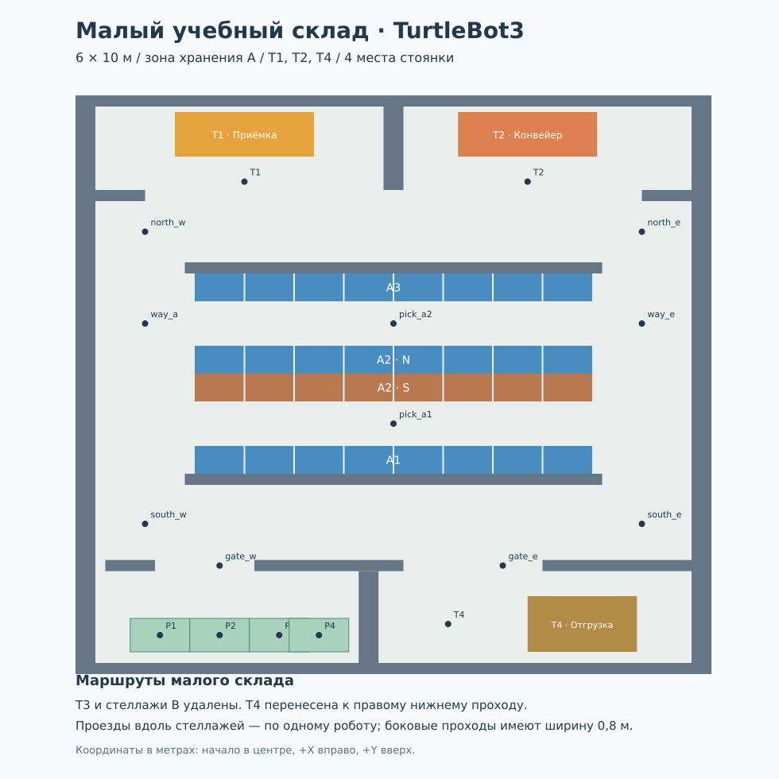

# Малый учебный склад



Это отдельный мир размером **6 × 10 м**, примерно вдвое уже большого склада.
В нём оставлены приёмка T1, конвейер T2, отгрузка T3,
три места стоянки и четыре ряда по семь раздельных стеллажей. Ряды у стоянки
обозначены А1 и А2, дальние — В1 и В2. Станок T3 удалён. Между стеллажами
оставлены физические промежутки, которые видит лидар.

Запуск Burger на P2 малого склада (`x=-1.75`, `y=-4.5`, направление +X):

```bash
~/LW-2/SCRIPTS/S2_startSim.sh world:=small
```

В параметрах запуска `x_pose` и `y_pose` можно указать другую стартовую позу.
Без аргумента `world` запускается этот малый склад. Для штатного примера DQN:

```bash
~/LW-2/SCRIPTS/S2_startSim.sh world:=stage4
```

## Навигация по готовой карте

Карта малого склада лежит рядом с большой в общей папке пакета:
`maps/warehouse_small.yaml` и `maps/warehouse_small.pgm`. Это синтетическая
эталонная карта, соответствующая стенам и препятствиям мира; для лабораторной
по SLAM всё равно создайте и сохраните собственную карту Cartographer.

```bash
source /opt/ros/humble/setup.bash
source ~/LW-2/ros2_ws/install/setup.bash
export TURTLEBOT3_MODEL=burger
WAREHOUSE_SHARE="$(ros2 pkg prefix --share turtlebot3_gazebo)"
ros2 launch turtlebot3_navigation2 navigation2.launch.py \
  use_sim_time:=true \
  map:="$WAREHOUSE_SHARE/maps/warehouse_small.yaml" \
  params_file:="$WAREHOUSE_SHARE/params/warehouse_${TURTLEBOT3_MODEL}.yaml"
```

После запуска Nav2 в RViz нажмите **2D Pose Estimate**, щёлкните около P2 на
карте и протяните стрелку вправо. Для готовой карты координаты P2 равны
`x=-1.75`, `y=-4.5`, `yaw=0`. При своей SLAM-карте выбирайте позу визуально на
карте, так как её координаты могут отличаться.

## Точки

`small_points_ground_truth.txt` содержит точки в формате MQTT-драйвера и
координаты Gazebo для визуальных меток. Для
эталонной карты доступны `parking`, `park_1`–`park_3`, `target1`, `target2`, `target3`,
 `gate_w`, `gate_e`, `south_w`, `south_e`, `north_w`, `north_e`,
`way_a`, `way_e`, `pick_a1`, `pick_a2`. Точки собственной SLAM-карты сохраните
заново через `teleop_keyboard_save.py` после локализации Nav2.

Пример маршрута: `parking → gate_w → south_w → way_a → north_w → target1 →
target2 → north_e → way_e → gate_e → target3`.
